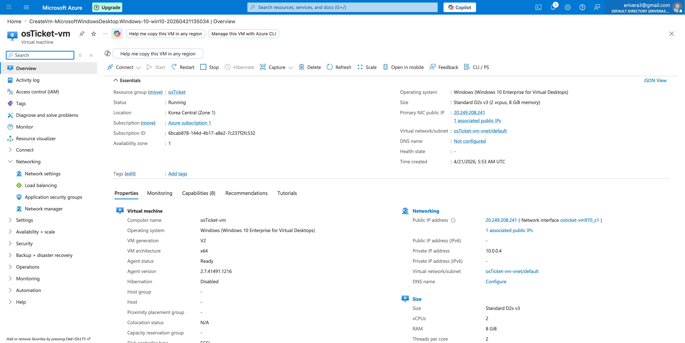
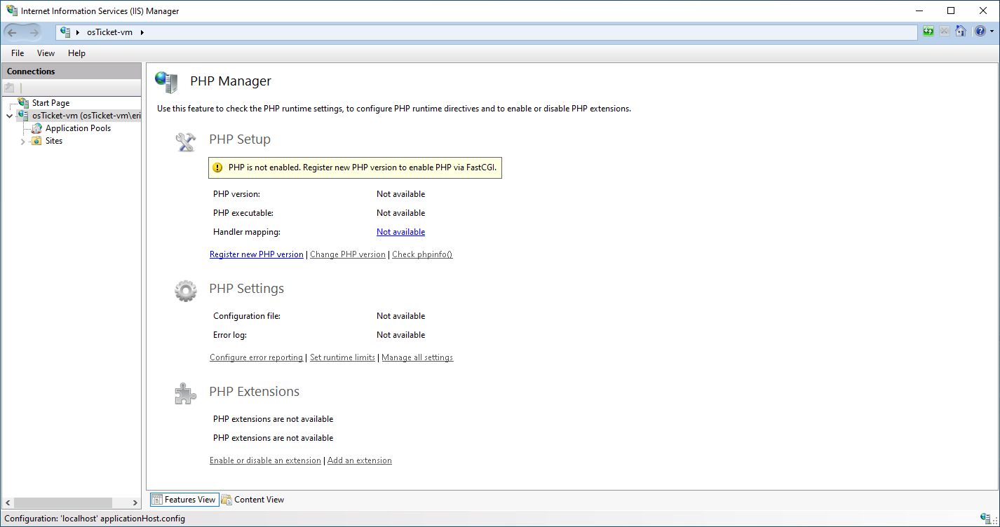
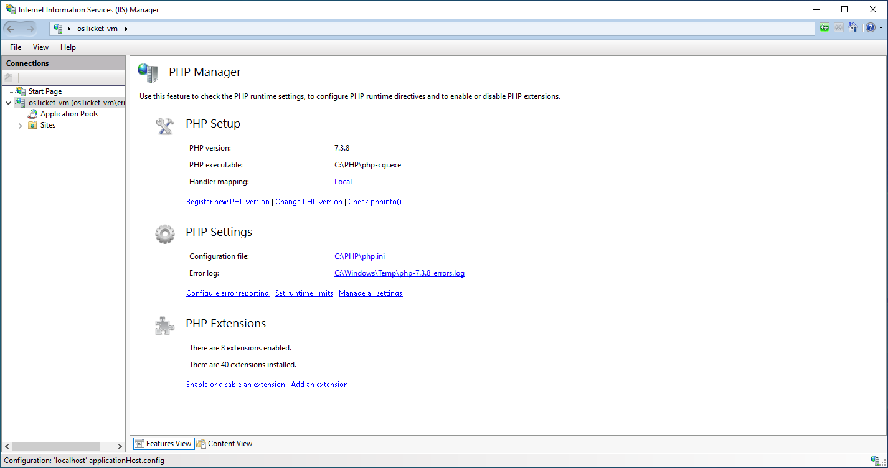
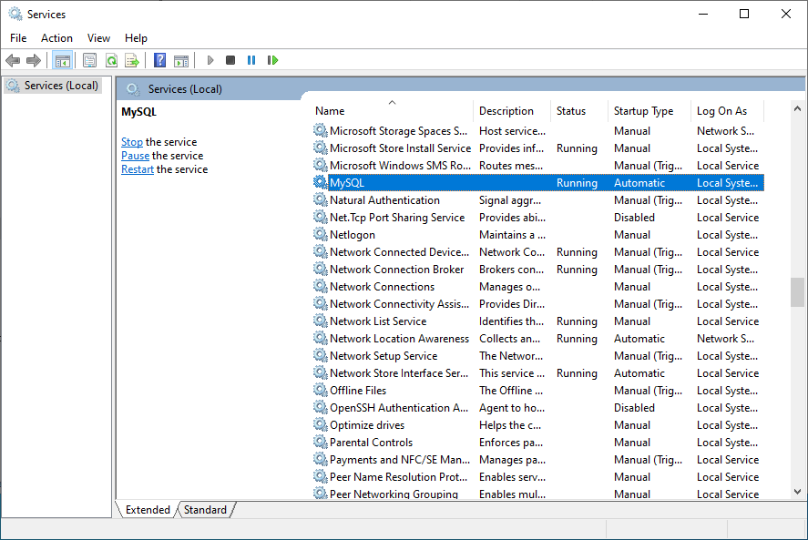
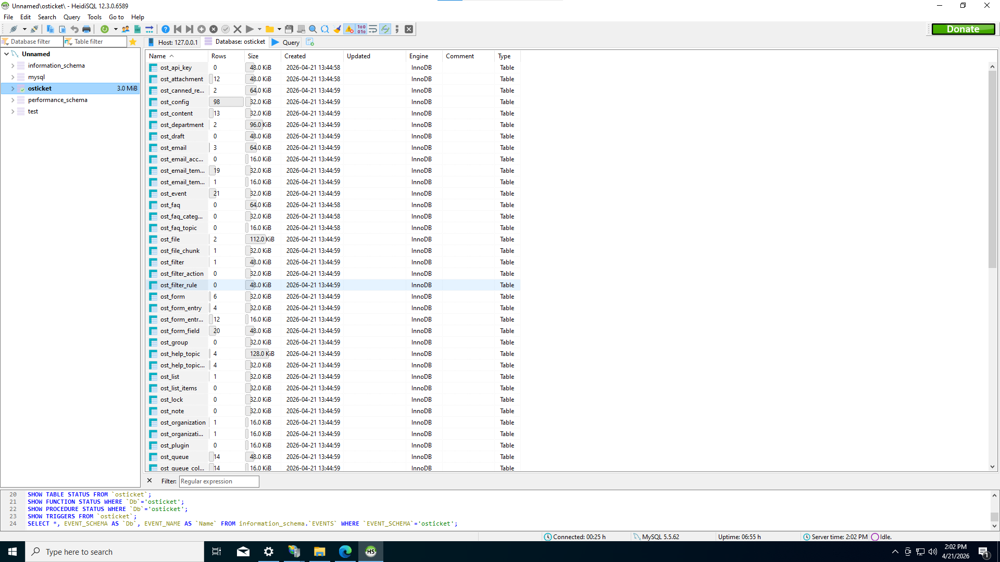
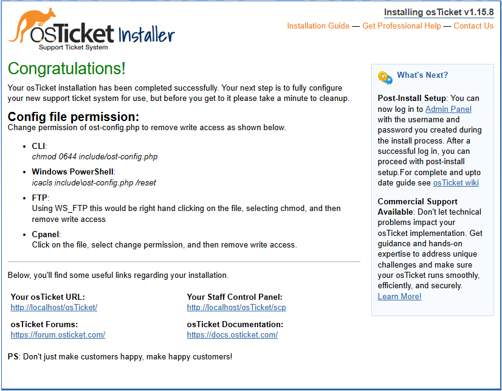
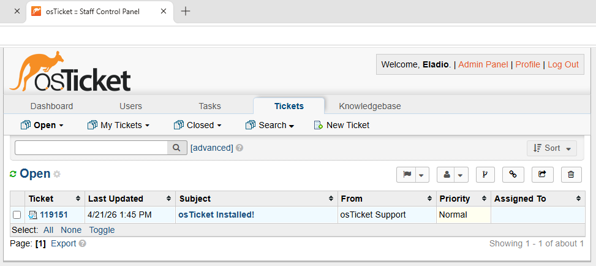
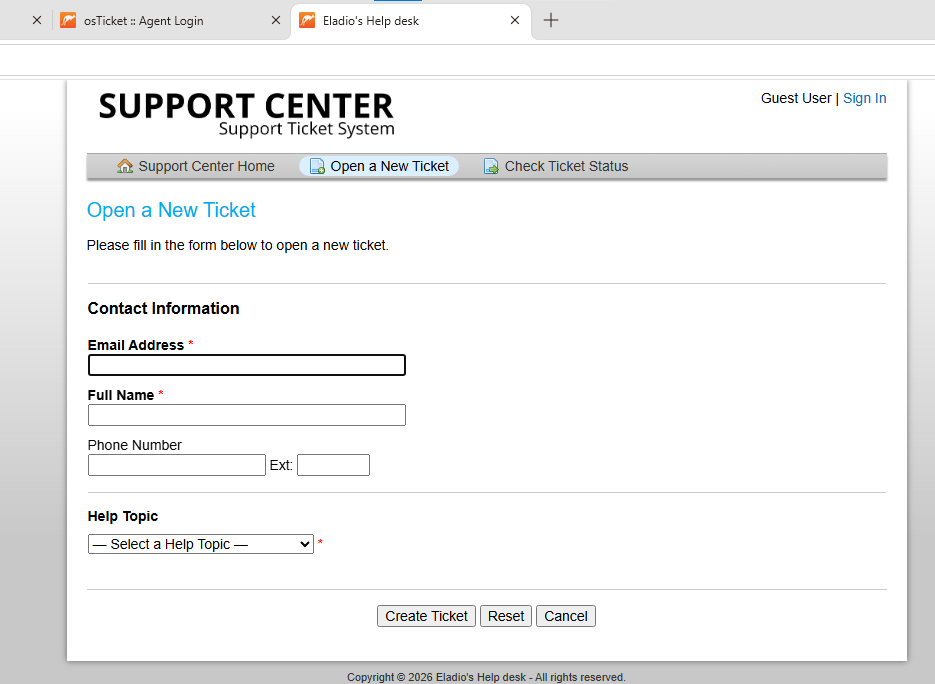

  

# osTicket Deployment in Azure

**Project context:** Structured technical lab

I installed osTicket on a Windows virtual machine in Azure and worked through the IIS, PHP, and MySQL dependencies needed to reach a working help desk interface.

## At a glance

- Configured IIS and connected PHP through FastCGI.
- Created the database and completed the osTicket installer.
- Checked administrative access and a sample ticket workflow.

**Skills practiced:** Application troubleshooting, dependency checks, configuration validation, and technical documentation.

**Related labs:** [Help desk configuration](https://github.com/erivera3/post-install-config), then [ticket lifecycle practice](https://github.com/erivera3/ticket-lifecycle).

[Back to my portfolio](https://github.com/erivera3)

<strong>Walkthrough, screenshots, and troubleshooting notes</strong>

## 📌 Context

A Windows-based environment was deployed in Azure to host osTicket. The system required coordination between:

- IIS (web server)
- PHP (application processing)
- MySQL (database backend)

Failure in any layer prevented the application from working.

---

## 🧰 Technologies Used

- Microsoft Azure (Virtual Machines)  
- Windows 10  
- Remote Desktop Protocol (RDP)  
- Internet Information Services (IIS)  
- PHP  
- MySQL  
- HeidiSQL  
- osTicket  

---

## 💻 Environment

- Windows 10 Virtual Machine (`osticket-vm`)  
- IIS with CGI enabled  
- PHP installed in `C:\PHP`  
- MySQL database  
- osTicket deployed in `C:\inetpub\wwwroot\osTicket`  

---

## ⚙️ Implementation

### 1. Infrastructure Setup

**Problem:**  
No working environment to host application.

**Decision:**  
Deploy Windows VM in Azure and establish remote access.

**Result:**  
- Functional system accessible via RDP  
- Base environment ready for service configuration  

  

---

### 2. PHP Execution Failure (Critical Blocker)

**Problem:**  
IIS could not process PHP files, blocking application execution.

**Root Cause:**  
PHP was installed but not registered with IIS.

**Decision:**  
Manually configure FastCGI and link `php-cgi.exe`.

**Result:**  
- PHP execution restored  
- Web server able to process application requests  

<table align="center">
  <tr>
    <td align="center">
       
      PHP Not Registered
    </td>
    <td align="center">
       
      PHP Registered
    </td>
  </tr>
</table>

---

### 3. Database Dependency Setup

**Problem:**  
Application required database backend to function.

**Decision:**  
Install MySQL and manually create database using HeidiSQL.

**Result:**  
- Database created and accessible  
- Tables successfully generated during installation  

  

  

---

### 4. Application Deployment

**Problem:**  
Application not yet integrated into web environment.

**Decision:**  
Deploy osTicket into IIS web root and complete installation via browser.

**Result:**  
- Application successfully installed  
- Web interface accessible  

  

---

### 5. System Validation

**Problem:**  
Need to confirm system functionality across all layers.

**Decision:**  
Test authentication and simulate ticket workflow.

**Result:**  
- Admin access verified  
- Ticket creation and handling confirmed  
- Full application functionality validated  

  

  

---

## 🔍 Key Failures & Resolutions

### PHP Not Executing
- Cause: Missing FastCGI configuration  
- Fix: Manual registration of PHP with IIS  

### Missing PHP Dependencies
- Cause: Required extensions disabled  
- Fix: Enabled extensions required by osTicket  

### Database Not Configured
- Cause: No backend defined  
- Fix: Created MySQL database and connected application  

---

## 🧠 Decisions That Mattered

- Chose IIS to align with Windows-based environments  
- Configured PHP manually to understand integration points  
- Validated each dependency before proceeding  
- Used direct database access (HeidiSQL) for verification  

---

## 🛡️ System Understanding

- Application stability depends on all service layers functioning correctly  
- Failures often occur at integration points, not installation  
- Troubleshooting requires isolating each layer independently  

---

## 📌 Key Lessons

- The failures documented here involved configuration and application dependencies  
- Dependency validation must happen before deployment  
- Fixing one layer does not guarantee full system functionality  
- Multi-service environments require step-by-step isolation  

---

## Summary

I diagnosed configuration issues across IIS, PHP, and MySQL and checked the application after integrating the services.

Instead of following a linear installation, this required:

- Identifying where execution failed (IIS vs PHP vs MySQL)  
- Restoring functionality at each layer  
- Validating full system behavior after integration  

**Result:**  
A working application environment built by resolving dependency failures, not just completing installation steps.

